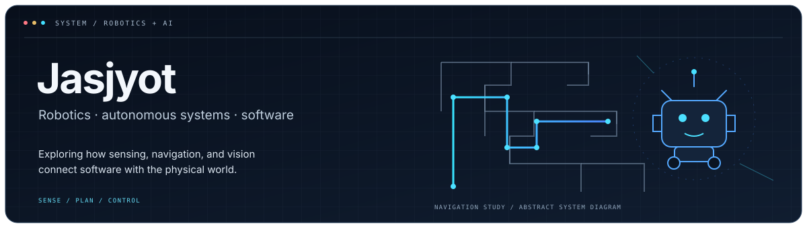
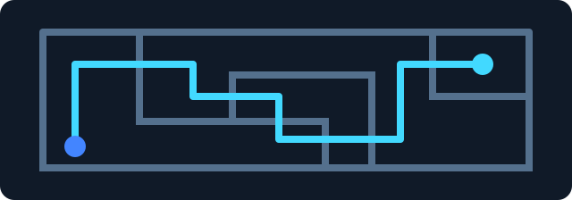
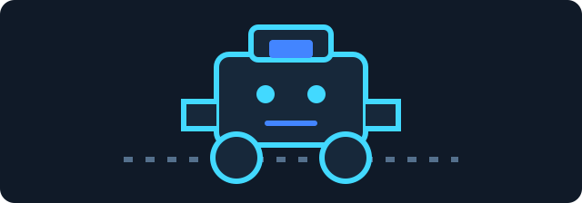
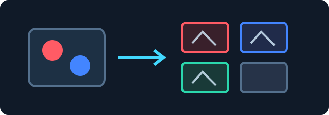

<picture>
  <source media="(prefers-color-scheme: dark)" srcset="dark.svg">
  <source media="(prefers-color-scheme: light)" srcset="light.svg">
  
</picture>

<h1 align="center">Jasjyot</h1>

<strong>Robotics + AI · Autonomous Systems · Embedded Software</strong>

I'm a student exploring how software and hardware work together—from sensing and navigation to computer vision and robot control. My projects include Arduino and LEGO Mindstorms EV3 experiments, plus Python/OpenCV vision examples.

## Technology

  
  
  
  
  
  
  

## Featured Projects

<table>
  <thead>
    <tr>
      <th align="left">Arduino Maze Navigation</th>
      <th align="left">EV3 Maze &amp; Line Projects</th>
      <th align="left">OpenCV Color Vision</th>
    </tr>
  </thead>
  <tbody>
    <tr>
      <td valign="top" width="33%">
        
        
Arduino sketches exploring maze-navigation logic, sensor input, and motor control. Hardware behavior is not claimed as verified.

        
<a href="https://github.com/Jasjyotsethi/arduino-maze-navigation">View repository →</a>

      </td>
      <td valign="top" width="33%">
        
        
Selected LEGO Mindstorms EV3 files for maze and line-following experiments. Program behavior remains to be verified.

        
<a href="https://github.com/Jasjyotsethi/ev3-maze-and-line-projects">View repository →</a>

      </td>
      <td valign="top" width="33%">
        
        
Python examples using OpenCV HSV masks to explore webcam color segmentation.

        
<a href="https://github.com/Jasjyotsethi/opencv-color-vision-experiments">View repository →</a>

      </td>
    </tr>
  </tbody>
</table>

## Currently Exploring

Autonomous navigation · Computer vision · AI for robotics

---

[Browse my repositories](https://github.com/Jasjyotsethi?tab=repositories)
