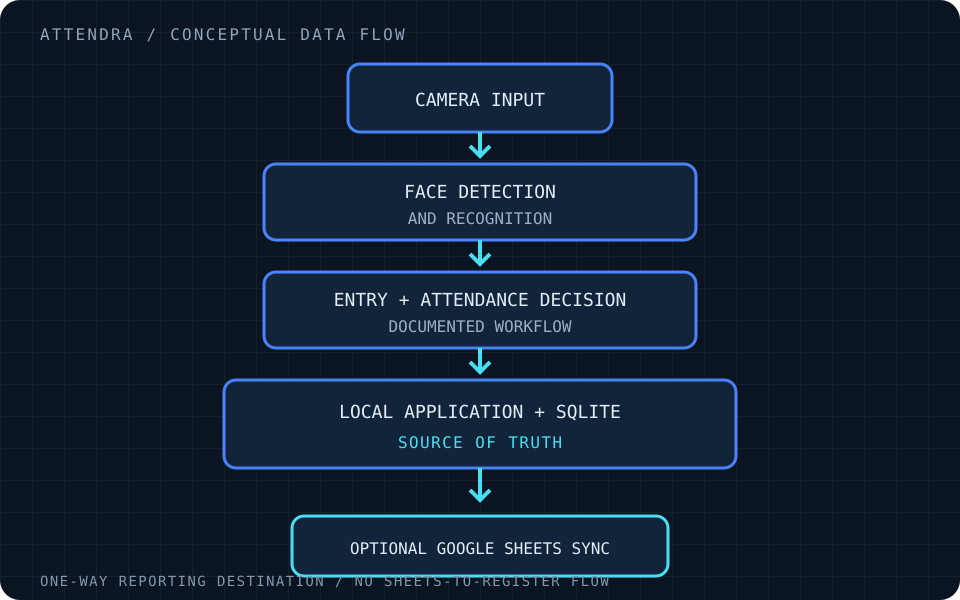
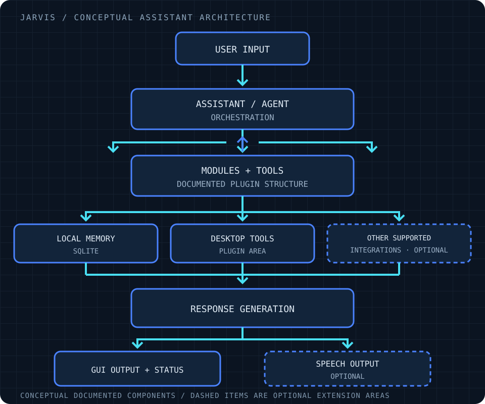

<picture>
  <source media="(prefers-color-scheme: dark)" srcset="dark.svg">
  <source media="(prefers-color-scheme: light)" srcset="light.svg">
  
</picture>

Student exploring how <strong>robotics, autonomous systems, computer vision, and software</strong> connect.

## Achievements &amp; Competitions

**ROBOCUP ASIA-PACIFIC · RESCUE MAZE · 2025** 
<code>2ND PLACE · TEAM RESULT · INDIA</code>

The official result sheet records second place for an India team entry. This is a team result; individual award attribution is not claimed here. [Official results →](https://2025.robocupap.org/wp-content/2025/Results/3.%20RCAP2025_Award_Junior_Rescue.pdf)

**ROBOCUPJUNIOR · RESCUE MAZE · 2026** 
<code>ARCHIVE-LISTED PARTICIPATION · NO PLACEMENT CLAIMED</code>

Participation is associated with the published 2026 Rescue Maze archive. No placement or individual technical contribution is claimed here. [2026 Rescue Maze archive →](https://robocup-junior.github.io/rcj-rescue-docs-site/2026/maze/)

## Featured Engineering Projects

- **01 / ATTENDRA** — Local-first attendance workflows with recognition, records, and optional cloud synchronization. [Project overview ↓](#attendra)
- **02 / JARVIS AI** — A modular local desktop assistant with voice, memory, and plugin-based components. [Project overview ↓](#jarvis-ai)
- **03 / ROBOTICS + VISION** — Arduino navigation, LEGO EV3 experiments, and OpenCV color-segmentation studies. [Project overview ↓](#robotics-and-computer-vision)

## Attendra

**AI attendance system · private source and data**

The project documentation describes face-recognition-based attendance for school workflows. SQLite is the local source of truth; Google Sheets can mirror records, and the documented workflow includes attendance registers and related corrections. The system is designed for potential use in real school environments; no deployment claim is made here.

**Documented current design** — Local attendance capture and records, SQLite storage, offline operation with queued synchronization, optional Google Sheets integration, and register workflows.

**Planned / pending validation** — Project notes mark some interface assets as future work. No production deployment, institutional approval, or real-world privacy/security validation is claimed. Public materials exclude source code, credentials, face data, student records, and databases.

## JARVIS AI

**Modular personal desktop assistant · source not published here**

The project README documents a local desktop assistant architecture with persistent SQLite memory, voice and text entry points, a GUI state display, and protocol-based speech, language-model, and wake-word components. The documented plugin structure includes desktop-control and automation areas.

**Documented current design** — Local memory, voice/GUI modes, asynchronous event routing, and modular components. The README describes optional local language-model and speech engines; this profile does not claim they are configured or tested on every machine.

**Planned / extension points** — The project documentation identifies future hardware integrations as an extension point. Broader desktop workflow coverage is not claimed here.

## Security Engineering

Security review work has focused on publication safety: credential and secret-handling checks, authentication and access-control considerations, and privacy review for sensitive data flows. These reviews inform what is kept private; this profile does not publish credentials, biometric data, student records, databases, or sensitive findings. No unverified security hardening claims are made.

## Robotics and Computer Vision

### 01 / Arduino Maze Navigation

Arduino sketches exploring maze-navigation logic, sensor input, and motor control. Hardware setup and behavior have not been verified here.

<code>C++</code> &nbsp; <code>Arduino</code> &nbsp; <code>Sensors</code>

[Open the repository →](https://github.com/Jasjyotsethi/arduino-maze-navigation)

### 02 / LEGO Mindstorms EV3

Selected EV3 project files for maze and line-following experiments. The available files do not establish verified program behavior.

<code>LEGO EV3</code> &nbsp; <code>Robotics</code> &nbsp; <code>Control</code>

[Open the repository →](https://github.com/Jasjyotsethi/ev3-maze-and-line-projects)

### 03 / OpenCV Color Vision

Python examples using OpenCV HSV masks to explore webcam color segmentation.

<code>Python</code> &nbsp; <code>OpenCV</code> &nbsp; <code>Computer Vision</code>

[Open the repository →](https://github.com/Jasjyotsethi/opencv-color-vision-experiments)

## Technology Toolkit

<strong>SOFTWARE</strong> <code>Python</code> &nbsp; <code>C++</code>

<strong>PLATFORMS</strong> <code>Arduino</code> &nbsp; <code>LEGO Mindstorms EV3</code>

<strong>DOMAINS</strong> <code>Computer Vision</code> &nbsp; <code>Robotics</code> &nbsp; <code>Embedded Systems</code>

## Current Focus

- **NAV / AUTONOMY** — Mapping, sensing, and motion-planning concepts.
- **EMBEDDED** — Hardware-software interfaces and control.
- **VISION** — Image processing and color segmentation.
- **ROBOTICS + AI** — Exploring how intelligent software can support physical systems.

---

[Browse all repositories →](https://github.com/Jasjyotsethi?tab=repositories)
