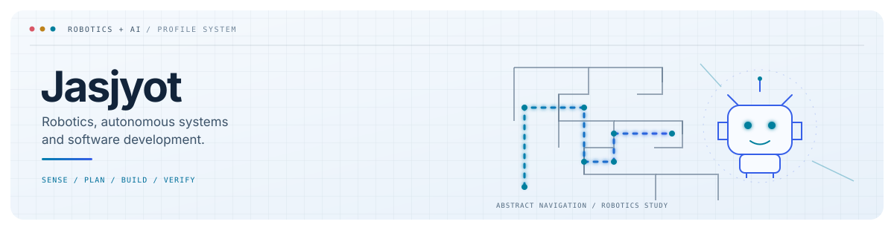

<picture>
  <source media="(prefers-color-scheme: dark)" srcset="dark.svg">
  <source media="(prefers-color-scheme: light)" srcset="light.svg">
  
</picture>

# Hi, I'm Jasjyot

I'm a student interested in **robotics, autonomous navigation, computer vision, AI, and software engineering**. My project work spans Python, C++, Arduino and embedded systems, and LEGO Mindstorms EV3.

I use these projects to explore sensing, control, and software design. Experimental code is identified as such; I do not describe a project as working unless its behavior has been verified.

## Selected work

- **RoboCupJunior Rescue Maze — The Worriers** · Team project documented in the [official RoboCupJunior archive](https://robocup-junior.github.io/rcj-rescue-docs-site/2026/maze/the-worriers/), including team materials and code. This is a team reference; individual contributions and competition placement are not implied here.
- **Arduino maze-navigation experiments** · Local sketches exploring navigation, sensors, and motor control. The selected sketches are not yet compiled or hardware-tested.
- **LEGO Mindstorms EV3** · Selected maze and line-following programs; behavior still needs verification and documentation.
- **Computer-vision experiments** · Selected OpenCV color-segmentation scripts, pending dependency and camera setup documentation.

## Interests

Robotics · Autonomous systems · Embedded systems · Computer vision · AI · Python · C++ · Arduino · LEGO Mindstorms EV3

## Find me

[GitHub profile](https://github.com/Jasjyotsethi)

---

Some prototypes remain private while security and privacy reviews are pending. This profile draft does not include their source code or associated data.
